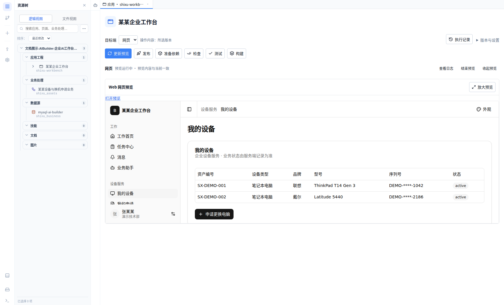
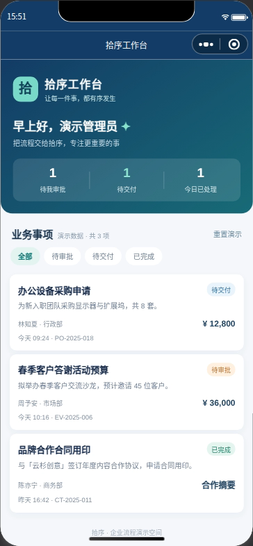
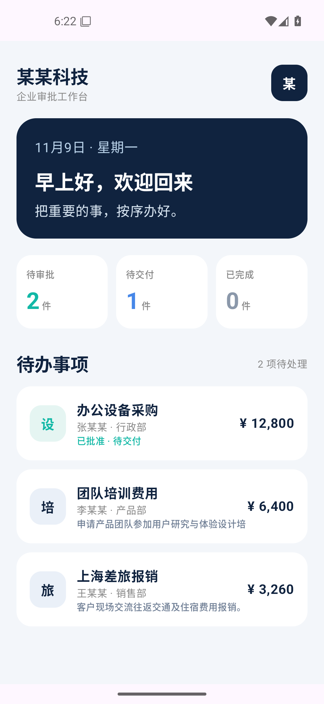
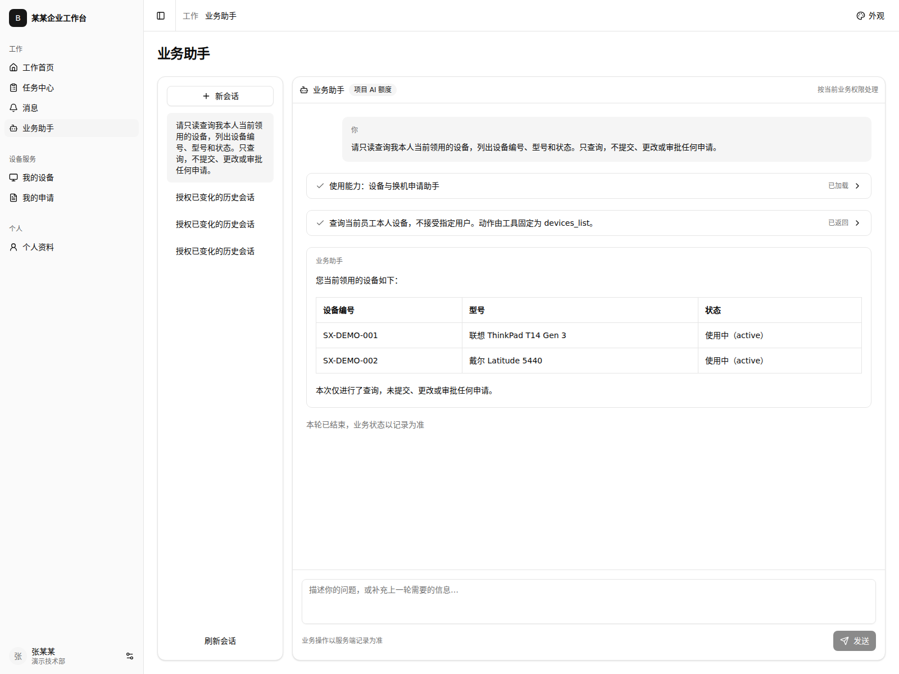

# Buildploy

### 让想法，成为可运行的应用。

与 AI 一起构建 **Web、微信小程序与 Android 应用**，连接业务数据和处理流程，在对应目标端预览、验证与交付。企业还可以构建通过自然语言使用业务能力的企业应用，并按需选择 **云端服务或私有化部署**。

[在线文档](https://www.buildploy.com/docs/) · [进入工作台](https://code.buildploy.com/) · [访问官网](https://www.buildploy.com/) · [快速入门](docs/quick-start.md) · [反馈问题](https://github.com/zbw911/buildploy/issues/new/choose)

*企业案例业务源码由产品内 AI Builder 编写；人工完成企业模板初始化、账号与私有运行配置，以及运行验收。[查看真实企业案例 →](docs/enterprise.md)*

## 从需求到应用，在一处连起来

| 你想完成的事 | Buildploy 提供的能力 |
| --- | --- |
| 把业务想法变成应用 | 用自然语言与 AI 协作，查看和调整真实项目源码，逐步完善页面与功能。 |
| 让页面连接业务 | 通过数据源、业务工作流与 API，把界面操作和业务处理接起来。 |
| 预览并交付多端应用 | 在 Web、微信小程序与 Android 的对应环境中查看真实效果、验证关键操作，再按目标打包交付。 |
| 使用自己的工程与工具 | 通过 Windows 桌面版接入本地 Git 工程，结合 Android、微信等原生工具推进开发。 |
| 帮助企业实现 AI 化 | 构建带有业务助手的企业应用，让员工通过自然语言调用授权业务工具，连接查询分析、业务办理与人工协作。 |
| 选择适合企业的部署方式 | 使用云端平台服务，或在企业私有环境部署平台；业务应用也可部署到云端或企业内网。 |

围绕 **Web、微信小程序、Android 和业务接口**组织应用能力；各目标端的可用操作与运行环境见[功能全景](docs/features.md)。

通过浏览器进入在线工作台，也可以使用 [Windows 桌面版](docs/desktop.md)连接本地工程与工具；桌面客户端当前面向内部试用。面向企业 AI 化的应用架构与场景案例，见[企业应用与 AI 协作](docs/enterprise.md)；平台与业务应用的部署选择见[云端与私有化部署](docs/enterprise.md#云端与私有化部署)。

## 认识 Buildploy

| 从这里了解 | 你将看到 |
| --- | --- |
| [整体架构](docs/architecture.md) | 工作台、AI、项目工程、业务资源与交付目标如何连接。 |
| [功能全景](docs/features.md) | 从需求表达、协作开发到运行验证和交付的完整路径。 |
| [核心功能 UI](docs/showcase.md) | 查看 AI Builder 真实创建的企业应用和小程序，以及工作台、业务流程、数据与交付入口。 |
| [小程序与 Android 预览](docs/mobile-preview.md) | 真实目标端中的应用界面、页面交互与状态变化。 |
| [桌面版支持](docs/desktop.md) | Windows 客户端、本地 Git 工程、工具检测与原生目标端验证。 |
| [企业应用与 AI 协作](docs/enterprise.md) | 用图解和案例了解 AI 如何连接企业数据、业务工具、权限和人工流程。 |

## 小程序与 Android，看见真实运行效果

让产品内 AI Builder 创建“某某工作台”，生成微信原生小程序与 Android 原生工程，并在真实目标端检查业务待办、详情与状态处理。

<table>
<tr><th>微信小程序</th><th>Android 应用</th></tr>
<tr><td align="center"></td><td align="center"></td></tr>
</table>

*小程序由 AI Builder 创建并完成平台游客预览与审批交互；Android 由 AI Builder 生成并构建，人工在专属模拟器验收，本次平台内设备预览尚未通过。均使用虚构的本地演示数据。[查看多端预览与交互 →](docs/mobile-preview.md)*

## 让 AI 进入企业的日常工作

AI Builder 帮助团队编写企业业务应用，应用内业务助手帮助员工查询和办理业务。在电脑更换案例中，员工用自然语言提出需求，模型查询设备信息、创建一条申请，并给出对应业务记录入口。

*已实测设备查询、单条申请创建与对应记录入口；主管页面审批已进入待交付。改名后只读查询并重新截图，保留原申请。业务源码由产品内 AI Builder 编写，人工完成企业模板初始化、账号与私有运行配置及验收。[查看企业 AI 化架构与真实案例 →](docs/enterprise.md)*

## 开始体验

打开[在线工作台](https://code.buildploy.com/)，登录后按照[快速入门](docs/quick-start.md)构建一个小需求，再通过实际操作检查运行效果。需要使用自己的模型、数据库或交付凭据时，阅读[模型及资源自主接入](docs/model-and-resource-access.md)。

[使用文档](docs/README.md) · [常见问题](docs/faq.md) · [路线图](docs/roadmap.md) · [已有 Issues](https://github.com/zbw911/buildploy/issues) · [反馈与文档贡献](CONTRIBUTING.md)

---

本仓库统一维护 Buildploy 官网、公开使用文档与问题反馈入口，不包含平台完整源码或通用安装包。云端与企业私有化部署按对应方案使用和交付，具体能力以所部署版本及目标环境为准。
