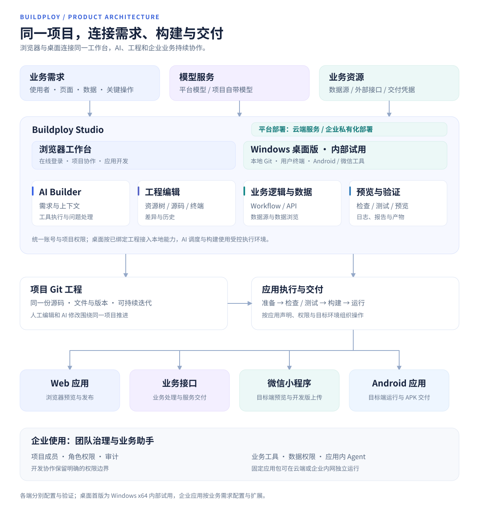

# 整体架构

Buildploy 围绕同一个项目组织需求、AI 协作、应用源码与运行操作。页面、业务逻辑和交付结果可以沿同一工程持续完善，让一次构建成为后续迭代的起点。

[文档目录](README.md) · [功能全景](features.md) · [核心功能 UI](showcase.md)

## 一个项目，连接开发与交付

| 组成 | 它解决的问题 |
| --- | --- |
| Studio 工作台 | 通过浏览器或 Windows 桌面客户端表达需求、与 AI 协作、编辑源码、组织业务逻辑，并查看运行结果。 |
| 项目工程 | 用 Git 管理应用文件和版本；人工编辑与 AI 修改围绕同一份源码推进。 |
| 应用执行 | 按工程声明准备依赖、检查、测试、构建和预览，保留可查看的日志、报告与产物。 |
| 交付目标 | 根据应用类型和环境，将成果交付为 Web、业务接口、小程序开发版或 Android APK。 |

例如，构建一个订单应用时，可以先完成订单列表，再加入搜索和详情；随后连接业务数据与处理接口，在预览中实际操作，最后按需要选择交付目标。调整功能时继续使用原项目、源码与历史。

## 桌面入口与企业应用

[Windows 桌面版](desktop.md)连接本地 Git 工程、用户终端和目标端工具；登录、AI 调度与平台 API 继续连接平台服务。项目保持明确的活动工作位置，在网页端查看本机项目时，需要对应桌面连接保持可用。

面向企业时，开发侧通过项目成员角色、权限与审计组织协作；业务侧可基于企业工作台模板构建带有业务助手的企业应用：员工向应用内 Agent 描述目标，Agent 在业务权限内使用 Skill 与工具连接数据查询、业务办理和人工流程。成员部门、应用角色、任务消息、附件与业务助手在同一应用中协作。业务应用可以按固定版本的应用包，在配套运行宿主和业务资源中独立运行，详见[企业 AI 化架构与案例](enterprise.md)。

## 云端与私有化部署

平台服务支持云端部署与企业私有化部署，浏览器和 Windows 客户端连接所选的平台实例。项目管理、AI 协作、执行环境与存储按部署方案配套，适应不同团队的网络和数据管理要求。

构建出的业务应用也可以部署到云端或企业内网，按固定应用包运行，并连接对应业务资源。平台与业务应用分别选择部署位置，详见[云端与私有化部署](enterprise.md#云端与私有化部署)。

## 按业务需要接入资源

AI Builder 可以使用平台模型，也可以配置项目自己的模型服务。应用的数据源、外部接口和交付凭据按项目需求配置；它们各自有明确的适用范围，详见[模型及资源自主接入](model-and-resource-access.md)。

架构图表达产品之间的关系。具体应用能够执行哪些操作，取决于工程声明、当前权限以及目标环境；各端的交付结果见[功能全景](features.md#目标端与交付结果)，原生运行界面与交互见[小程序及 Android 预览](mobile-preview.md)。
