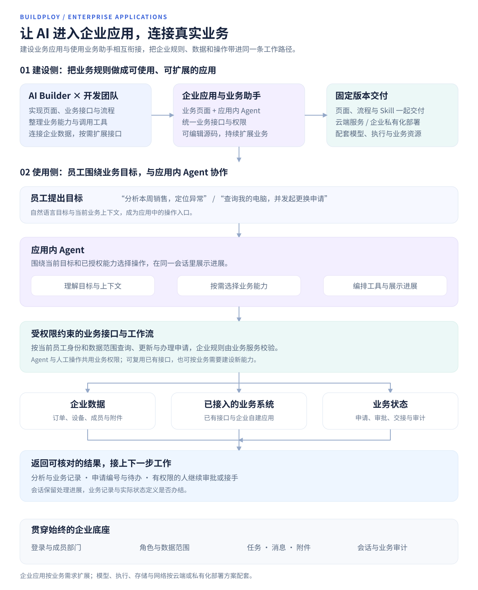
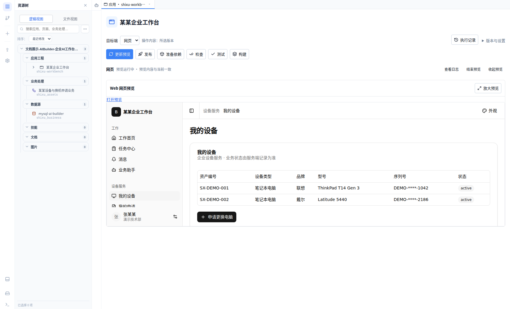
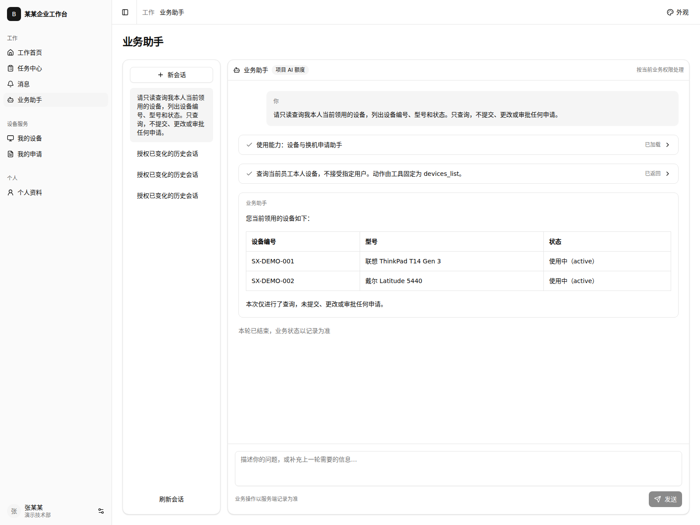
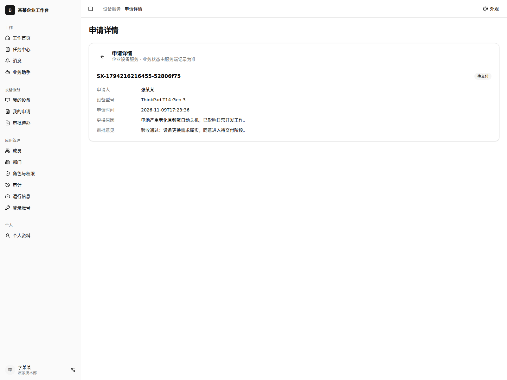
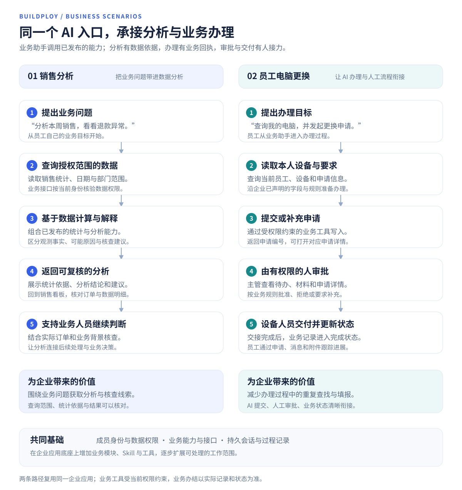
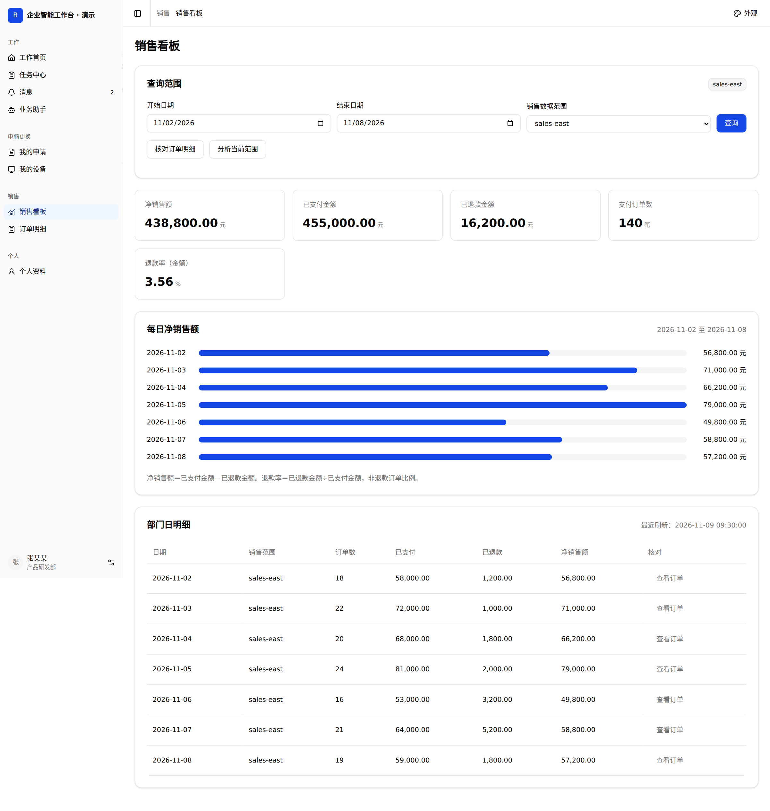

# 企业应用与 AI 协作

让员工直接说出业务目标，由应用内的 AI 助手结合已授权的数据和业务工具推进任务，再回到同一应用查看结果、处理待办和核对记录。Buildploy 将 AI 协作开发、业务应用和应用内 Agent 连接起来，帮助企业把 AI 能力融入日常工作。

[文档目录](README.md) · [整体架构](architecture.md) · [功能全景](features.md) · [云端与私有化部署](#云端与私有化部署)

## 从构建应用，到用 AI 办理业务

| 企业 AI 化的两个环节 | Buildploy 如何支持 | 企业得到什么 |
| --- | --- | --- |
| 构建和扩展应用 | 用 AI Builder 与人工编辑完善页面、业务接口、工作流及 Skill，检查后按固定版本交付。 | 可以持续演进的企业应用与业务能力。 |
| 在应用中使用 AI | 员工用自然语言提出目标，应用内 Agent 按需加载已发布的 Skill、调用业务工具，并返回结果与业务记录入口。 | 从业务目标出发，连接查询、分析与办理的工作方式。 |

在这类 AI Native 应用中，自然语言业务入口与业务工具、角色权限、处理状态和结果记录共同构成工作流程。企业可以从一个具体场景开始，把已有的业务接口与数据逐步接入，再扩展到更多部门和任务。

## 真实案例：AI Builder 建设企业业务应用

“某某企业工作台”以员工张某某和主管李某某的电脑更换流程为例。基于系统的官方企业模板，产品内 AI Builder 编写并修正业务页面、Workflow、Agent 与 Skill；人工完成模板初始化、独立账号和业务资源准备、私有运行配置与验收。

*实际系统 UI，员工登录后查询自己的两台演示设备。工程在平台中检查、构建并按固定来源运行。*

### 从自然语言到真实申请

员工先让业务助手查询自己的设备，再提出电池老化、频繁关机的更换需求。真实模型加载设备办理 Skill，调用授权查询工具取得设备，再通过申请工具创建业务记录，返回真实申请编号和关联入口。

*原始验收已通过真实模型创建申请并返回关联记录入口。设备和人员为虚构演示数据；本次匿名化后重新查询本人设备与同一申请的实际状态来取图，没有重复提交或审批，旧会话和原申请保留。*

### 权限与人工协作进入同一流程

员工可以查看、提交自己的申请，没有主管审批权限。本次使用员工会话尝试审批，服务端拒绝且记录保持待审批。主管随后在真实待办中打开同一申请，填写意见并批准；员工和主管重新打开详情，均看到“待交付”和同一审批意见。

*批准仅进入待交付，后续设备交接仍由对应人员办理。[查看员工权限与回看画面](../assets/screenshots/builder-enterprise-employee-permissions.png) · [查看审批后助手读取的实际状态](../assets/screenshots/builder-enterprise-assistant-status.png)。*

本次验证覆盖真实模型查询、一次申请创建、关联记录入口、员工权限拒绝、主管页面审批与结果回看。开发和网页预览在系统工作台中进行；真实模型及业务验收采用该项目固定应用包的独立 Launcher 私有运行配置。应用经过 AI Builder 迭代修正，人工负责部署准备和验收；本次仅在本地验证，未线上发布。展示用的应用名称与姓名经人工匿名化，原项目、账号权限及申请记录保留。

## 可扩展场景：销售分析

例如：“帮我查看本月授权范围内的销售情况，说明需要关注的变化。”可以将已有销售查询组织为工具，让助手结合授权统计说明范围与依据，再回到销售看板核对指标和订单明细。

*销售界面复用已有组件，使用虚构数据与示例会话展示扩展方向；销售场景未纳入本次真实模型调用验收。*

## 企业应用底座

AI 助手能够调用什么、看见哪些数据、怎样影响业务，由应用的业务能力和服务端权限共同决定。企业工作台模板提供可二开的应用源码，让这些能力与业务界面一起组织和交付。

| 支撑能力 | 如何帮助企业实现 AI 化 |
| --- | --- |
| 业务接口与工作流 | 将查询、提交、审批等业务动作提供为明确的工具入口；AI 与人工页面使用业务接口，复用业务规则。 |
| Skill 与工具编排 | 将业务办理说明与可调用工具一起发布，助手按目标使用相应能力，也可以在同一会话中组合多项已授权能力。 |
| 成员、部门与业务角色 | 按当前员工、角色和数据范围检查每次业务访问，让助手在实际授权范围内工作。 |
| 业务记录与关联入口 | 通过真实工具回执关联订单、申请等业务对象，员工能够打开详情继续核对与办理。 |
| 待办、消息与附件 | 将 AI 发起的业务动作接回已有审批、材料和交接流程，让团队继续协作。 |
| 会话、审计与运行状态 | 查看处理过程与历史；按当前权限恢复会话，核对业务操作和结果，持续维护应用。 |

企业业务通过新增模块、接口、Skill 和权限声明扩展，具体业务规则与接入效果按企业需求开发和验证。可以复用已有工作台和模块，也可以像本次电脑更换案例一样，借助 AI Builder 建设新的业务能力。

## 团队开发与治理

开发团队通过组织与项目配置参与者，使用拥有者、编辑者、只读查看者三类项目角色组织协作。服务端检查访问和修改权限，Git 保存源码版本与变更；平台管理人员可在授权范围内查询审计记录。

项目开发权限与业务使用权限分别管理。开发人员可以建设和维护应用，员工在应用中使用业务角色和数据授权；助手不会因为模型回答或项目成员身份而获得额外业务权限。

## 云端与私有化部署

Buildploy 提供云端服务，也支持按企业环境进行私有化部署。可以直接使用在线工作台，或将平台服务部署到企业管理的服务器与网络中，根据自身的数据管理、系统连接和运维要求组织开发工作。

| 部署对象 | 云端方式 | 企业私有化方式 |
| --- | --- | --- |
| Buildploy 平台 | 通过云端平台使用工作台、项目管理、AI 协作与应用交付能力。 | 在企业管理的环境中部署平台服务，配套账号、数据存储、执行环境及模型接入。 |
| 构建出的业务应用 | 将 Web、业务接口和企业应用部署到云端运行环境，按业务需要提供访问入口。 | 以固定应用包配合运行宿主，部署到企业服务器或内网，连接对应业务数据库和资源。 |

浏览器与 Windows 桌面客户端连接所选的平台服务；私有化环境使用企业自己的工作台地址。平台的开发协作与业务应用的运行可以分别选择部署位置，实际连接和访问按网络策略配置。

业务应用按固定版本交付页面、接口及已发布的业务能力。数据库连接、密钥、附件与运行状态按部署需求分别配置和保存，便于明确各项资源的管理归属。

私有化方案需要配套模型连接、执行与存储资源，以及目标端工具链。AI Builder 与业务助手需要能够访问对应的模型服务；业务助手通过所部署平台的模型网关使用模型。资源接入范围和网络条件见[模型及资源自主接入](model-and-resource-access.md)，具体部署范围、交付内容和验证按实际环境确定。

企业可以先选择一个有明确数据、业务动作和完成标准的场景，基于企业工作台模板连接所需接口、声明工具与 Skill、配置权限，再验证“提出目标 → 业务处理 → 结果核对 → 人工接力”的完整路径。[快速入门](quick-start.md)介绍应用构建与验证的基本流程。

关于这些设计取向背后的思考，见[关于 AI Native 的理解](ai-native.md)。
