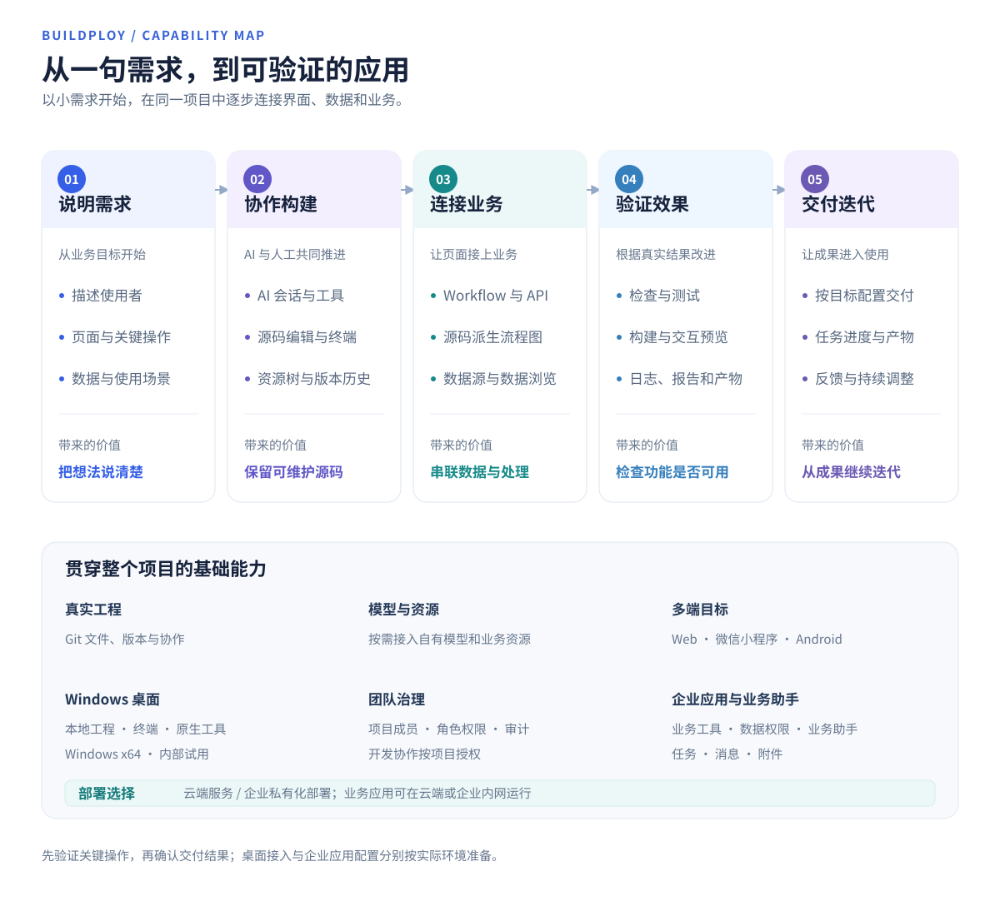

# 功能全景

从“我想做一个什么应用”开始，Buildploy 将协作开发、数据和业务逻辑、运行验证与交付连接起来。可以先完成一个小功能，再沿同一项目逐步扩展。

[文档目录](README.md) · [整体架构](architecture.md) · [核心功能 UI](showcase.md)

## 从想法到可验证的应用

| 阶段 | 可以完成的工作 | 对你的价值 |
| --- | --- | --- |
| 说明需求 | 用自然语言描述使用者、页面、数据和关键操作，在 AI 会话中持续补充与调整。 | 从业务目标开始，把需求逐步变成明确的功能。 |
| 协作构建 | AI 结合你提供的项目上下文修改源码、执行工具；在资源树、编辑器和终端查看或继续完善实现。 | AI 与人工编辑围绕同一工程协作，源码可以持续维护。 |
| 连接业务 | 使用 Workflow 与 API 组织处理逻辑；查看源码派生流程图；配置 MySQL 数据源、浏览表结构与查询结果。 | 把页面操作与业务处理连接起来，理解数据从哪里来、经过什么处理。 |
| 验证效果 | 按应用提供的操作进行检查、测试、构建和预览，查看执行日志、报告和产物。 | 根据实际结果检查功能，围绕具体问题继续改进。 |
| 交付迭代 | 按目标选择交付内容，查看任务进度与结果，再回到项目继续调整。 | 从开发过程延伸到可使用的成果，保留迭代入口。 |

## 开发入口与企业应用

| 能力 | 适合的场景 | 进一步了解 |
| --- | --- | --- |
| 浏览器工作台 | 直接在线表达需求、编辑工程、组织业务逻辑并查看运行结果。 | [快速入门](quick-start.md) |
| Windows 桌面版 | 接入本地 Git 工程，结合本机工具、Android 模拟器和微信开发者工具协作开发；当前面向内部试用。 | [桌面版支持](desktop.md) |
| 团队开发治理 | 通过组织与项目管理协作范围，用项目角色、服务端权限和审计保留操作边界与记录。 | [企业级支持](enterprise.md#团队开发与治理) |
| 企业业务助手 | 员工用自然语言提出目标，助手按权限调用已发布的业务工具，关联业务记录、待办和人工处理；团队可继续扩展模块与能力。 | [企业 AI 化架构与案例](enterprise.md) |
| 云端与私有化部署 | 选择云端平台服务或企业私有平台；业务应用可在云端或企业内网运行，按方案配置网络和资源。 | [部署选择](enterprise.md#云端与私有化部署) |

桌面版属于开发入口；Web、小程序和 Android 属于应用目标。企业应用既需要业务功能，也需要身份、权限和部署资源的配套配置。

## 目标端与交付结果

| 目标 | 典型用途 | 交付与验证方式 |
| --- | --- | --- |
| Web | 业务管理页面、运营台、信息展示与交互应用。 | 浏览器预览；按项目配置发布 Web 应用。 |
| 业务接口 | 页面调用、数据查询与业务处理。 | 通过 Workflow/API 定义和验证接口，按依赖与配置交付业务服务。 |
| 微信小程序 | 微信内使用的业务应用。 | 在对应环境中预览、验证；配置凭据后上传微信开发版。 |
| Android | 需要 Android 运行环境的应用。 | 在目标环境中运行和验证，构建并交付 APK。 |

[小程序与 Android 实际预览](mobile-preview.md)展示原生目标端中运行的业务案例、页面跳转与状态操作。各目标分别配置和验证；微信上传开发版、Android APK 构建与应用商店上线分别核对实际结果。

## 接入自己的模型与业务资源

项目可以接入自己的兼容模型服务，并按需配置 MySQL、工作台工作流使用的 Redis 或外部 HTTP API。配置入口、连接测试和发布后运行的支持范围各不相同，统一见[模型及资源自主接入](model-and-resource-access.md)，避免仅凭已保存配置判断接入完成。

准备开始时，跟随[快速入门](quick-start.md)完成一个小需求，并实际检查关键操作；[核心功能 UI](showcase.md)提供一个订单应用的完整展示路径。
