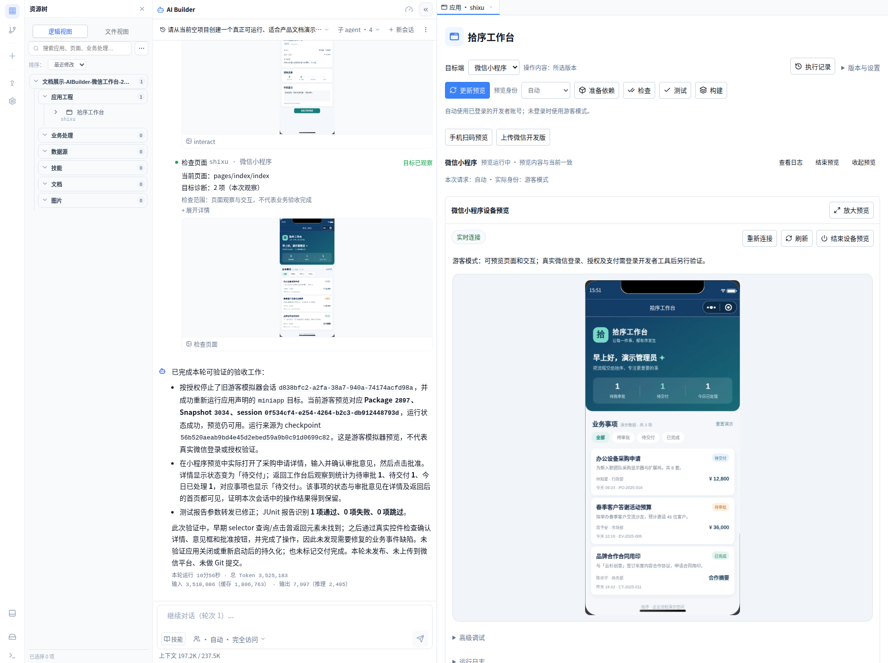
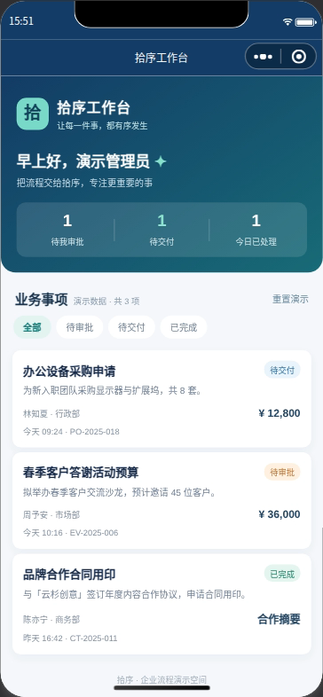
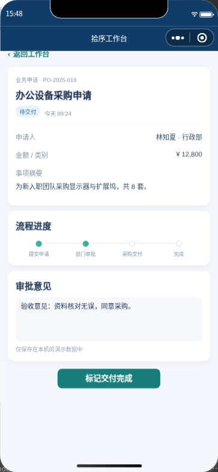
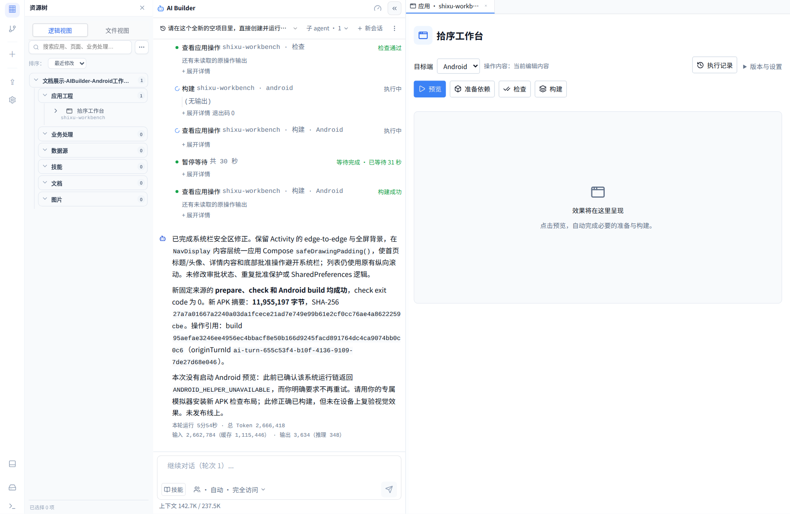
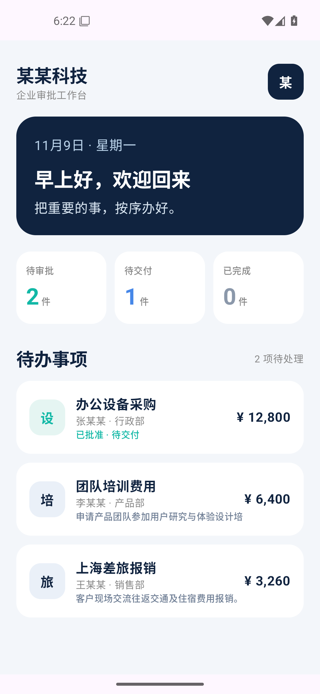

# AI Builder 创建的小程序与 Android 应用

从业务需求出发，让产品内 AI Builder 创建原生工程、实现页面和状态处理、执行构建，再到真实目标端操作。“某某工作台”以虚构的企业待办和采购审批为例，展示这条路径的实际结果。

[文档目录](README.md) · [功能全景](features.md) · [核心功能 UI](showcase.md) · [企业应用与 AI 协作](enterprise.md)

两个工程均由产品内 AI Builder 从空项目生成，过程中由人工补充指令。Android 还经过人工选择项目的官方执行镜像；业务功能由 AI Builder 编写，没有导入此前的独立演示应用；本次按展示需要，人工修改应用名称与演示姓名后重新构建截图。本次未发布。

| 目标端 | 实际运行方式 | 已验证的行为 |
| --- | --- | --- |
| 微信小程序 | AI Builder 构建并启动平台内微信开发者工具游客预览。 | 打开详情、填写意见、批准到待交付、返回首页核对状态与统计。 |
| Android | AI Builder 构建 APK；人工将平台返回的构建 APK 安装到专属模拟器。 | 安装启动、详情、批准到待交付、统计更新、避免重复审批、重启后保留状态。 |

## 微信小程序

系统工作台将 AI Builder、应用工程与小程序设备预览放在同一个页面，便于对照需求和运行效果继续调整。本次改名后从原项目重新构建，截图展示同一工程的实际预览。

*实际系统 UI，预览内容来自该项目的固定源码和平台运行操作。*

原始验收由 AI Builder 在真实页面中填写意见并批准采购申请；本次改名后在新的游客预览会话中，由人工通过相同页面重新验证。申请进入“待交付”，返回首页后，待审批／待交付／已处理统计更新为 1／1／1。批准不代表已完成交付。

此案例使用游客身份与本地虚构数据。关闭重启后的持久化、真实微信登录、授权、支付及上传开发版未纳入本次验证。

## Android 应用

AI Builder 创建 Kotlin / Jetpack Compose 工程并完成实际 APK 构建。系统 UI 展示原项目、源码与构建记录；本次平台内设备预览遇到辅助组件协议或能力不匹配，尚未通过。

*实际系统 UI。平台内设备预览未通过，不能将下面的本地验收画面视为平台内预览成功。*

在保留 AI Builder 已修正的系统栏安全区逻辑后，人工修改展示名称并重新构建 APK，核对构建产物与安装后文件的摘要一致，再在本次专属 Android 模拟器中验证页面和本地业务状态。匿名化 APK 在另一台独立模拟器中重新安装验收，原模拟器及其数据保留。

已验证：从三条待办进入详情并批准，统计由 3／0／0 更新为 2／1／0；重新打开详情时不能重复批准，关闭并重新启动应用后继续保留状态。这里的业务数据为本地演示数据，未接入真实企业后端或身份权限。

## 从预览继续交付

应用页按目标提供检查、测试、构建和运行入口，结合原操作的日志、产物与目标端画面核对结果。验证通过后，小程序可按配置上传微信开发版，Android 可交付 APK；目标端环境和能力分别验收。

从需求开始构建，见[快速入门](quick-start.md)。本地工具接入见[桌面版支持](desktop.md)，扫码预览、上传和登录配置见[微信小程序配置指南](wechat-miniapp-configuration.md)，其他凭据和资源见[模型及资源自主接入](model-and-resource-access.md)。
