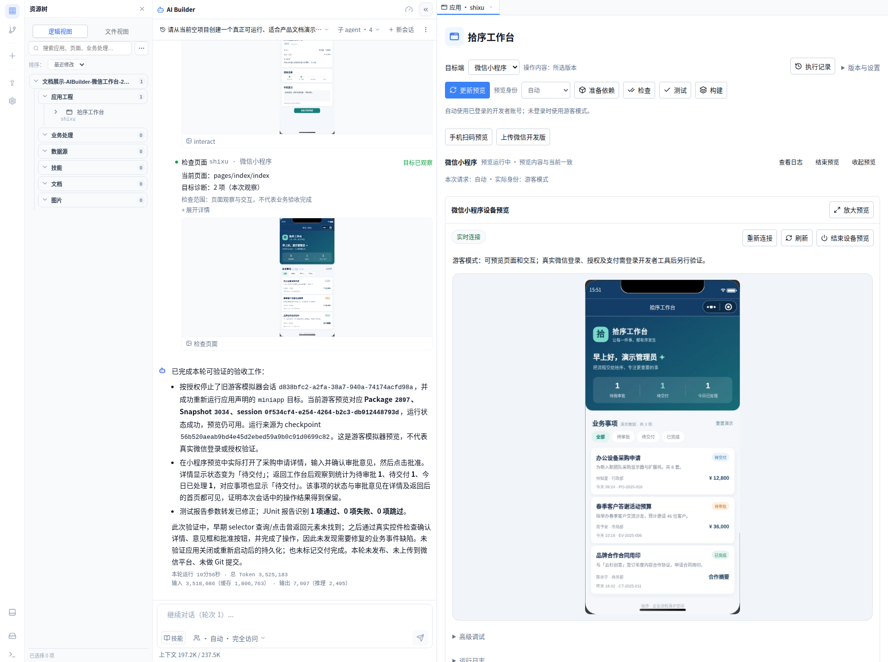
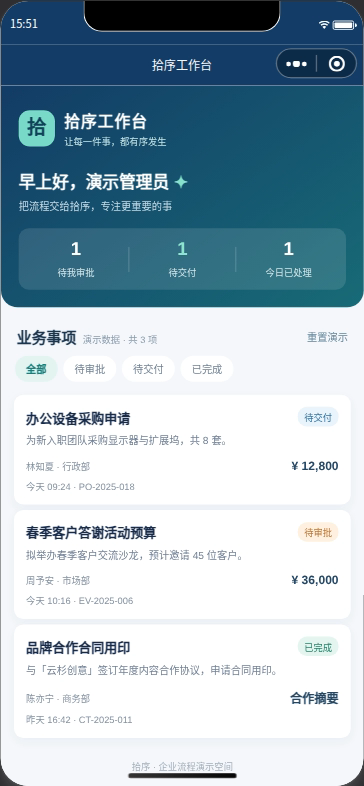
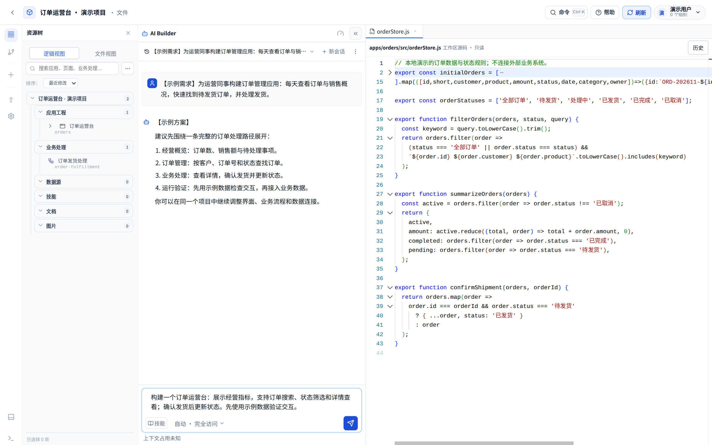
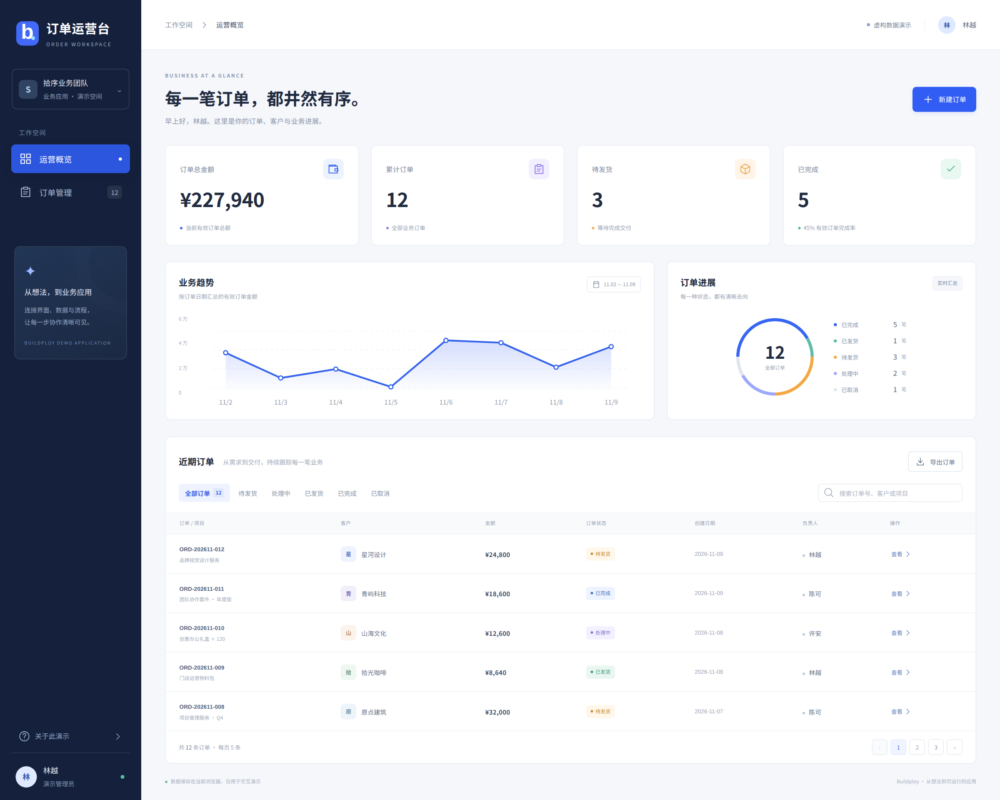
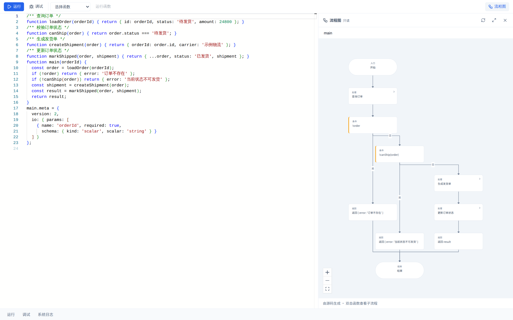
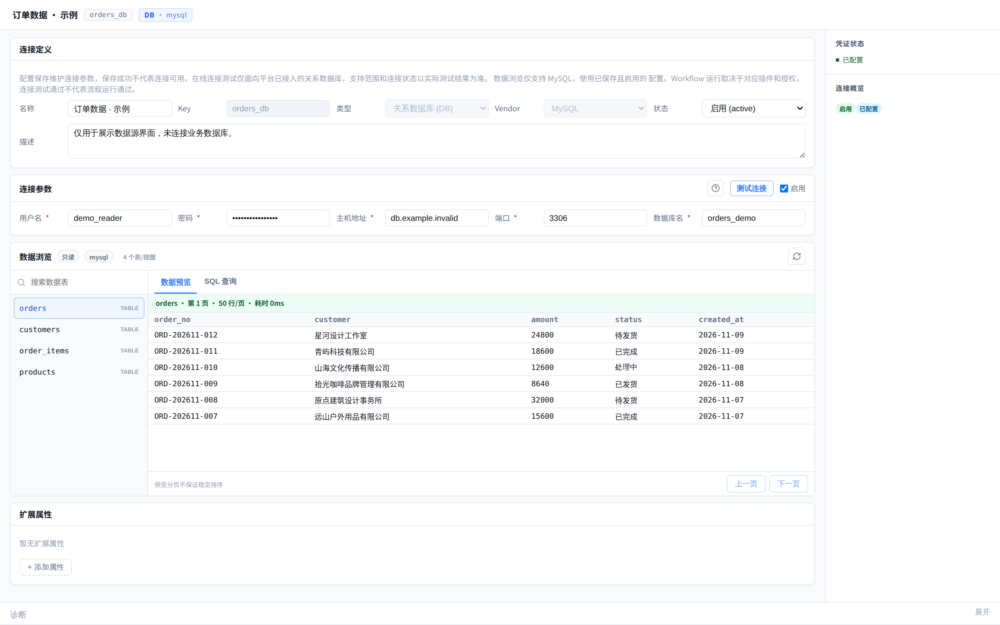
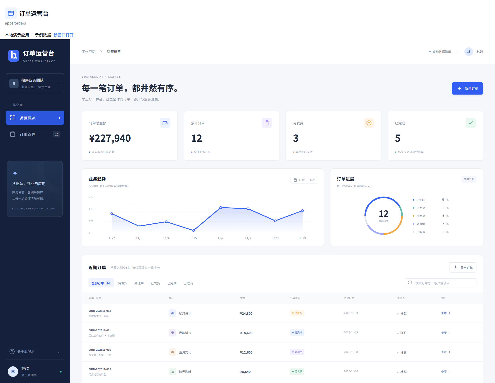
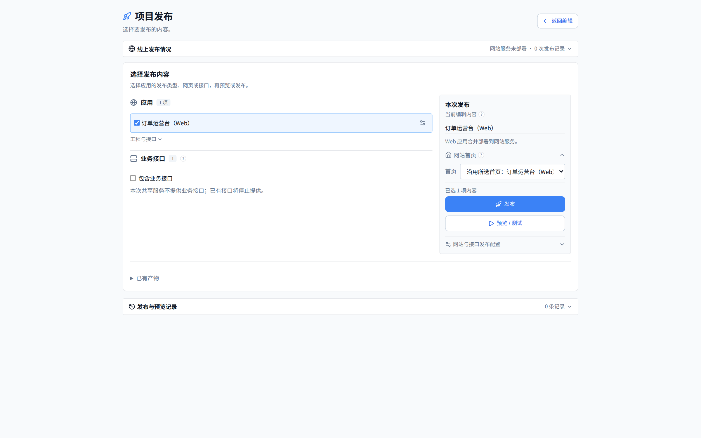

# 核心功能 UI

先看 AI Builder 实际创建的小程序，再通过“订单运营台”演示项目查看业务流程、数据与交付入口。

[文档目录](README.md) · [整体架构](architecture.md) · [功能全景](features.md)

> 本页使用虚构数据。“拾序工作台”小程序由产品内 AI Builder 生成，人工在过程中补充了指令。订单运营台与相关示例会话是为文档准备的本地展示素材，不作为 AI Builder 实际生成记录。本次案例均未执行线上发布。

## AI Builder 真实创建的小程序

向 AI Builder 描述企业待办、事项详情与状态处理需求，由它在项目内生成微信原生小程序源码，并执行工程构建和平台预览。此案例经过人工补充指令，逐步完成初始化、依赖准备与运行；画面保留实际会话和操作记录。

*同一工作台中的 AI Builder 与真实目标端预览。小程序以游客身份运行，使用虚构的本地演示数据。*

*已验证工程生成、构建与平台游客预览。AI Builder 实际填写审批意见并批准申请，详情进入“待交付”且保留意见；返回首页后，待审批／待交付／已处理统计为 1／1／1，采购事项显示“待交付”。[查看审批结果](../assets/screenshots/builder-miniapp-approval.png)。重启后的状态保留、真实微信登录与支付尚未验收。*

## 1. 围绕同一个项目协作

在工作台中提出业务目标，同时查看项目资源和源码。需求、源码与运行入口保留在同一个工作空间，便于边观察结果边调整实现。

*当前 Studio 界面，使用演示工程；AI 栏展示示例需求与协作会话。*

## 2. 从需求到可交互的应用

订单运营台提供概览指标、订单列表、搜索、状态筛选和详情，并可以创建订单、确认发货。统计随演示操作更新，刷新后保留本地状态。

*实际运行的本地演示应用，使用虚构数据和浏览器本地存储。可按自己的业务继续扩展数据与处理逻辑。*

## 3. 理解业务处理流程

Workflow 将业务处理写在源码中，流程图从源码派生，帮助查看步骤与关系。图与源码沿同一来源维护，方便理解订单处理等业务逻辑。

*当前业务流程界面与演示源码；图中展示处理结构。*

## 4. 查看业务数据与结构

在数据源界面组织连接信息、查看表结构与数据。在连接真实业务前，可以先确认字段、访问权限和查询需求，再按实际环境验证。

*当前数据源界面，展示隔离的示例结构与数据；此图不表示已连接真实业务库。配置支持范围见[资源接入指引](model-and-resource-access.md)。*

## 5. 预览并检查实际效果

从应用入口查看可交互画面，围绕搜索、筛选、详情等关键操作检查结果。需要定位问题时，结合当前执行记录、日志和产物继续处理。

*预览区域加载本地演示应用的真实构建产物；应用本地构建与平台操作结果分别核对。*

## 6. 选择交付内容与目标

交付入口将应用、业务接口与目标配置组织在一起。根据业务需要选择内容和目标，再查看实际任务、产物与访问入口。

*当前交付界面与演示配置，展示操作入口；本次案例未执行线上发布。*

微信小程序与 Android 的原生目标端运行画面，见[多端实际预览](mobile-preview.md)。这些图片展示的是共用工作台组件与本地演示应用；Windows 客户端的本机接入见[桌面版支持](desktop.md)，应用内 Agent、销售分析与申请办理的图解和界面见[企业应用案例](enterprise.md)。

开始构建自己的应用，可以从[快速入门](quick-start.md)进入。已有场景但不确定如何组织时，先描述使用者、关键数据和最重要的一步操作。
