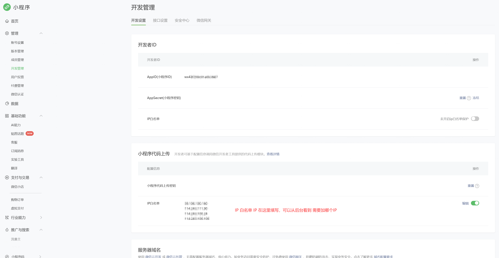

# 微信小程序配置：预览、上传与登录

先为同一个小程序配置 AppID、代码上传私钥和服务器出口 IP 白名单，再发起手机扫码预览或上传微信开发版。业务微信登录和真机接口按需另行配置。

[文档目录](README.md) · [小程序预览案例](mobile-preview.md#微信小程序)

## 先分清五项配置

| 配置项 | 用途 | 配置位置 |
| --- | --- | --- |
| AppID（小程序 ID） | 标识预览、上传和业务登录对应的小程序 | 微信后台查看；Buildploy「小程序身份」保存 |
| 上传私钥（`.key`） | 微信 CI 扫码预览、上传代码 | 微信后台「小程序代码上传」下载；Buildploy「扫码预览与上传」保存 |
| 代码上传 IP 白名单 | 允许 CI 服务器发起预览和上传请求 | 微信后台「小程序代码上传」，填入实际 CI 服务器的公网出口 IP |
| AppSecret（小程序密钥） | 业务微信登录等服务端接口，不用于上传代码 | 微信后台获取；Buildploy「业务微信登录」保存 |
| 服务器合法域名 | 允许真机小程序请求业务 HTTPS 接口 | 微信后台「服务器域名」，填写实际业务接口域名 |

应用配置需要项目编辑权限，私钥和 AppSecret 由项目所有者保存。两类密钥不能互换，请在对应设置项录入，不放入源码或公开截图。

## 微信后台在哪里配置

登录[微信公众平台](https://mp.weixin.qq.com/)，进入 **开发管理 → 开发设置**，对照下图查看 AppID、上传密钥、白名单和服务器域名。



*参考图保留原有脱敏处理，可点击放大。*

**上传 IP 要填在下方「小程序代码上传」的白名单中，不是上方「开发者 ID」区域的 IP 白名单。**

## 三步配置 AppID、私钥和 IP

### 1. 保存 AppID

从微信后台「开发者 ID」复制 AppID，在 Buildploy **目标应用 → 微信小程序设置 → 小程序身份** 中填写「微信 AppID」，点击「保存小程序身份」。核对「生效 AppID」与微信后台一致；已有工程绑定发生冲突时，先统一身份，再保存私钥。

### 2. 保存代码上传私钥

在微信后台「小程序代码上传」生成或下载该 AppID 的 `.key` 文件，再到 Buildploy **扫码预览与上传** 中选择「代码上传私钥」，点击「保存上传私钥」。确认显示「已配置代码上传私钥」。私钥重置后需重新保存新文件；平台不回显已保存的私钥。

### 3. 配置出口 IP 并加入白名单

由部署管理员在控制服务的配置文件或 env 文件中维护真实出口 IP。单个出口的示例是 `BUILDPLOY_MINIAPP_CI_EGRESS_IPS=203.0.113.10`；多个出口以英文逗号分隔：

```dotenv
BUILDPLOY_MINIAPP_CI_EGRESS_IPS=203.0.113.10,198.51.100.20
```

**以上是示例地址，不能直接用于实际白名单。** IP 必须由管理员确认是实际执行微信 CI 的服务器公网出口。修改配置后重启控制服务。

回到 Buildploy **扫码预览与上传 → 服务器出口 IP**，逐项复制显示的 IP，添加到微信后台 **小程序代码上传 → IP 白名单 → 编辑**，全部保存后重试预览或上传。

未显示 IP 时，请联系部署管理员；其他设置仍可读取和保存。不要填写浏览器客户端、电脑局域网或容器内网 IP。列表来自部署配置，面板不会探测或猜测公网地址；服务器或 NAT 出口变化后需同步更新两边。

出口 IP 的界面显示随平台更新提供。尚未升级的平台可先由部署管理员提供实际出口 IP，完成微信白名单配置。

## 继续预览或上传

配置完成后，在应用入口选择「手机扫码预览」或「上传微信开发版」，按面板提示操作并查看原任务结果。**上传成功仅表示进入微信开发版，审核和正式发布在微信公众平台完成。**

电脑里的开发者工具预览使用「开发者工具账号」分组；它与小程序的业务微信登录分别配置。各类预览、上传及登录都需要核对实际操作结果。

## 按需配置业务登录和真机接口

**业务微信登录：** 在同名分组保存同一 AppID 的「微信登录 AppSecret」，按面板提示准备登录能力并「检查接入条件」，随后在小程序中验证真实登录。检查通过不等于真实登录已经通过；仅做扫码预览或上传无需配置 AppSecret。

**真机接口：** 确认业务接口使用 HTTPS，在微信后台「服务器域名」加入实际接口域名。Buildploy 的「业务微信登录 → 本应用接口地址」在使用项目托管后端时通常可留空，由预览或发布流程选择；独立后端按实际地址填写。重新构建后在真机验证请求，上传白名单不能代替合法域名配置。

## 常见问题

| 现象 | 优先检查 |
| --- | --- |
| 私钥无效或上传无权限 | AppID 与 `.key` 是否匹配，私钥是否已重置 |
| 提示 IP 不在白名单 | 是否填在「小程序代码上传」区域，是否遗漏实际出口或因服务器迁移而失效 |
| Buildploy 未显示出口 IP | 联系管理员补齐部署列表并重启控制服务 |
| 真机页面打开，但接口失败 | HTTPS、服务器合法域名、接口地址和后端可用性 |
| 微信业务登录失败 | AppID 与 AppSecret、共享登录能力、实际使用的后端接口 |

## 微信官方参考

- [微信公众平台](https://mp.weixin.qq.com/)：身份、密钥、白名单、域名、审核与发布。
- [小程序 CI](https://developers.weixin.qq.com/miniprogram/dev/devtools/ci.html)：预览、上传与 CI 配置；也可参考[微信官方 CI 仓库](https://github.com/wechat-miniprogram/miniprogram-ci-dist)。
- [网络能力与服务器域名](https://developers.weixin.qq.com/miniprogram/dev/framework/ability/network.html)：真机网络配置。
- [小程序登录](https://developers.weixin.qq.com/miniprogram/dev/framework/open-ability/login.html)：微信登录流程。
